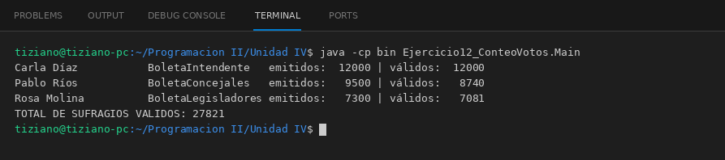

# BoletaElectoral

Programación II - Unidad 4 - Ejercicio 12

## Consigna
Contar los sufragios válidos de distintas boletas con una invocación unificada.

## Lógica
- Clase abstracta `BoletaElectoral` (nombreCandidato, partidoPolitico) con `int contarVoto(int cantidadEmitida)`; valida que no haya cantidades negativas.
- `BoletaIntendente` cuenta todos los votos, `BoletaConcejales` descarta un 8 % por tachas y `BoletaLegisladores` un 3 % por preferencias inválidas.
- `CentroComputos.totalizar(...)` recorre la lista de boletas y suma los votos válidos.
- `Main`: una boleta de cada tipo y el total de sufragios válidos.

## Ejecución

